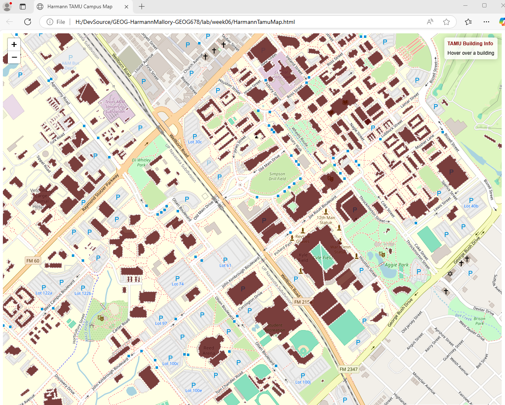

# Texas A&M Campus Building Explorer

**Tools:** JavaScript, Leaflet, GeoJSON-style FeatureCollection

An interactive campus map that renders building-footprint polygons and supports map-based exploration. The source dataset contains approximately 889 building features. The application demonstrates loading geographic features in the browser, styling polygons, highlighting features on hover, displaying building information, and zooming to selected features.

## Run locally

Open `index.html` in a modern browser with an internet connection. The page loads Leaflet from the unpkg CDN and the local `tamubuildings.js` data file.

## Data note

The building-footprint data is included in the source coursework archive. Before making this repository public, verify the dataset's original source, license, and required attribution with the course/source provider. Do not represent the dataset as original work.

## Preview

